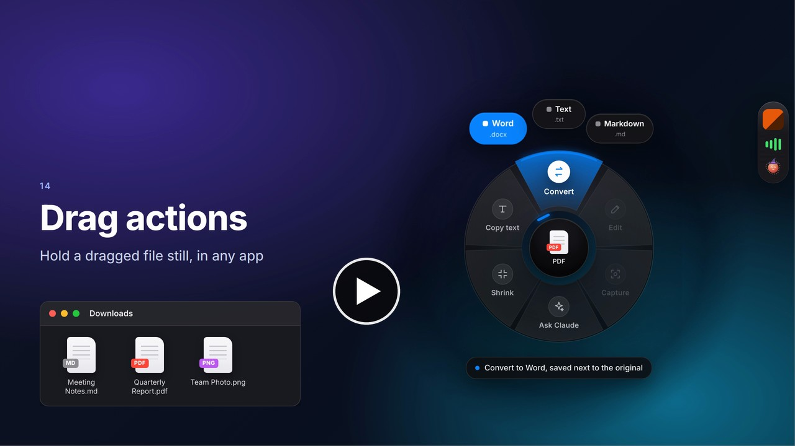

# Dynamic Island

[](https://github.com/shashanksharma280201/dynamic-island-linux/actions/workflows/ci.yml)
[](https://github.com/shashanksharma280201/dynamic-island-linux/releases/latest)
[](LICENSE)

A Dynamic Island for your desktop: a small capsule on the edge of your screen
that shows what's going on (music, messages, mail, notifications, your Claude
Code sessions) and lets you act on it without leaving what you're doing.
Linux, macOS and Windows. Free and open source.

[](docs/media/dynamic-island-tour.mp4)

**[Watch the 1 minute video](docs/media/dynamic-island-launch.mp4?raw=true)**, or the
[4 minute tour](docs/media/dynamic-island-tour.mp4?raw=true). Both are recorded from
the real app with made-up data.

## This is the Windows branch

It has everything on `main`, plus what Windows needs (`electron/platform/win32.ts`). See [what's different on Windows](docs/platforms.md#windows), and [Install on Windows](docs/install.md#install-on-windows) to build it from the code.

## Download

**[Dynamic Island v0.4.0](https://github.com/shashanksharma280201/dynamic-island-linux/releases/tag/v0.4.0)**
([what's new](CHANGELOG.md)). Install it with one command, and run the same
command again later to update.

On **Linux or a Mac**, in Terminal:

```bash
curl -fsSL https://raw.githubusercontent.com/shashanksharma280201/dynamic-island-linux/main/scripts/install.sh | bash
```

On **Windows**, in PowerShell:

```powershell
irm https://raw.githubusercontent.com/shashanksharma280201/dynamic-island-linux/main/scripts/install.ps1 | iex
```

Or download the installer:

| Your computer | Download |
|---|---|
| Linux | [.deb](https://github.com/shashanksharma280201/dynamic-island-linux/releases/download/v0.4.0/dynamic-island-linux-0.4.0-amd64.deb) for Ubuntu and Debian, or the [AppImage](https://github.com/shashanksharma280201/dynamic-island-linux/releases/download/v0.4.0/dynamic-island-linux-0.4.0-x86_64.AppImage) |
| Mac with Apple silicon | [.pkg](https://github.com/shashanksharma280201/dynamic-island-linux/releases/download/v0.4.0/dynamic-island-mac-MSeries-0.4.0-arm64.pkg) (or the [.dmg](https://github.com/shashanksharma280201/dynamic-island-linux/releases/download/v0.4.0/dynamic-island-mac-MSeries-0.4.0-arm64.dmg)) |
| Mac with Intel | [.pkg](https://github.com/shashanksharma280201/dynamic-island-linux/releases/download/v0.4.0/dynamic-island-mac-intel-0.4.0-x64.pkg) (or the [.dmg](https://github.com/shashanksharma280201/dynamic-island-linux/releases/download/v0.4.0/dynamic-island-mac-intel-0.4.0-x64.dmg)) |
| Windows 10 or 11 | [.exe](https://github.com/shashanksharma280201/dynamic-island-linux/releases/download/v0.4.0/dynamic-island-windows-0.4.0-x64.exe) |

The installers aren't signed yet, so your system asks once before opening
them: [here's how](docs/install.md#opening-the-downloaded-installer). To build
it from the code instead, see [Install](docs/install.md).

## What it does

- **Now Playing**: album art and a waveform on the capsule, with play, pause, skip and seek for Spotify, YouTube and any media player.
- **Messages and mail**: WhatsApp messages and new mail pop up as cards, and you reply right there.
- **Claude Code, live**: every session in your terminals shows what it's doing and what it changed. Allow its permission prompts, answer its questions and read its plans from any app.
- **Drag actions**: drag any file and hold still, and a ring opens to convert it, shrink it, copy its text or ask Claude about it.
- **Phone Drop**: flick a photo or file from your Android phone toward the screen; it comes out of a glow at the edge and lands in the island.
- **An assistant**: Claude, ChatGPT, Gemini, DeepSeek, OpenRouter or Ollama, and it asks before it sends or changes anything.
- **Documents and a CRM**: merge, split and convert files, have Word files corrected as tracked changes, and keep a simple CRM.
- **Notifications**: every app's notifications on the island, a notification center, and Do Not Disturb.
- **A character**: Orbit, Bolt or Puff shows what's going on. Dress it up, put it on your desktop, and get a recap of your week every Monday.
- **Control Center**: volume, brightness, Wi-Fi and Bluetooth, one click away.

Everything is optional and works without accounts. Your settings, notes,
documents and CRM stay on your computer. See [all features](docs/features.md).

## Get started

Once installed, the island sits on the right edge of your screen. Drag it
anywhere along the edges or to the top center, and click it (or press
**Ctrl+I**) to open the panel. Then connect what you use, from **Settings**:

- [Claude Code](docs/setup.md#connect-claude-code), to follow your sessions and answer their prompts on the island
- [An AI provider](docs/setup.md#use-any-ai) for the assistant
- [WhatsApp](docs/setup.md#connect-whatsapp), [mail](docs/setup.md#add-a-mail-account) and [Spotify](docs/setup.md#connect-spotify)
- [Documents](docs/setup.md#work-with-documents), [drag actions](docs/setup.md#drag-actions) and the [CRM](docs/setup.md#your-own-crm)

## Works on

| System | Version |
|---|---|
| Linux | Ubuntu or another GNOME desktop on X11. It runs on Wayland too, [with limits](docs/troubleshooting.md#limitations). |
| macOS | 11 Big Sur or newer, Apple silicon or Intel ([what's different](docs/platforms.md#macos)) |
| Windows | 10 or 11, 64-bit ([what's different](docs/platforms.md#windows)) |

## Documentation

- [Install](docs/install.md): installers, building from the code, updating, uninstalling
- [Features](docs/features.md): everything the island does
- [macOS and Windows](docs/platforms.md): what's different there
- [Set it up](docs/setup.md): Claude Code, AI providers, WhatsApp, mail, Spotify, documents, drag actions, the CRM
- [Configuration, privacy and security](docs/configuration.md)
- [Troubleshooting and limitations](docs/troubleshooting.md)
- [Development](docs/development.md): running it from the code, tests, how it works, releasing
- [What's new](CHANGELOG.md)

## Contributing

Bug reports, ideas and pull requests are welcome: see
[CONTRIBUTING.md](CONTRIBUTING.md). Report vulnerabilities privately, as
[SECURITY.md](SECURITY.md) describes, and follow the
[Code of Conduct](CODE_OF_CONDUCT.md).

## License

[MIT](LICENSE) © 2026 Shashank Sharma. Bundled work keeps its own license:
the Inter typeface (SIL Open Font License), [thinking-orbs](https://libraries.dev/orbs)
by Jakub Antalik (MIT), and the libraries in `package.json` (MIT, Apache-2.0
and BSD).

Dynamic Island is an independent project, not made by or affiliated with
Apple. "Dynamic Island" names the iPhone feature that inspired it.
