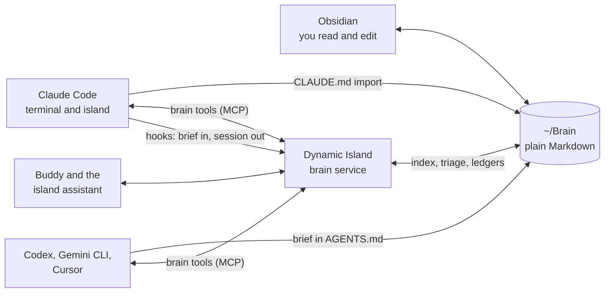
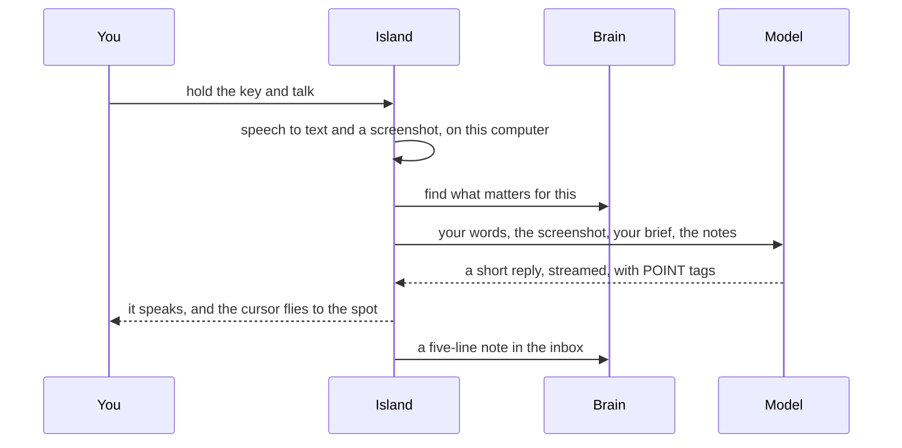

# Island Brain and Buddy

*Research and plan, 7 November 2026, for dynamic-island-linux.*

How to give you and every AI you use one shared memory that stays on your computer, turn the island's character into a buddy that talks, sees your screen and points, grow it into a Jarvis, and make Ubuntu feel like an AI OS. It covers what others have built, what to borrow, what to build, and in what order.

<div class="tldr">

**The short version**

- **The brain is a folder you own.** An Obsidian vault at `~/Brain` in the Living Brain layout: plain Markdown, kept in local git, no cloud needed.
- **The island looks after it.** The island already runs an MCP server and already gets hook events from every Claude Code session, terminal ones included. It gains brain tools at a fixed local address, a short brief at the start of every session, a five-line note filed at the end of each one, local search, and the Living Brain loop on a schedule.
- **Every AI reads the same map.** Claude Code through a one-line import plus the brain tools. Codex, Gemini CLI and Cursor through a brief the island keeps in their global instruction files, plus the same tools. The island's assistant and the buddy read it directly.
- **The character becomes your buddy.** Hold a key and talk. It answers out loud while a cursor flies to the thing it means on screen, like Clicky. The difference: the voice runs on your machine, it knows you, it can walk you through several steps, and it asks before it acts.
- **Six phases, brain first.** Each phase ends with something you use every day. Build on X11 now, and add a small GNOME Shell extension later for Wayland.

</div>

## What you asked for

1. One second brain shared by you and AI, so Claude Code, the Claude API and any other AI tool know you and your work. Everything stays local.
2. A personal buddy that lives in the island and knows you well, with [Clicky](https://github.com/farzaa/clicky) as the model.
3. A complete redesign of the island and its Settings window.
4. Ubuntu personalised into something closer to an AI OS.
5. The best ideas from developers' Jarvis projects, taken further.

## What others have built

### The Living Brain method

The [Living Brain guide](https://skool.twohourceo.com/living-brain/) (Two Hour CEO, 17 chapters, all read in full) is the backbone of this plan. Its ideas, in its own words where it matters:

- **Own the map, rent the model.** "The most valuable thing your AI builds is not your chats. It is the map." The map lives in "plain files, on a computer you own. Not an app. Not a database." Models are engines you swap; "the harness stays; the engine swaps."
- **One shared memory.** "Every agent reads from it before acting, and writes back into it after." It is "just a folder".
- **The folder:** `01 Inbox`, `02 Projects`, `03 Areas` (one hub note per department), `04 Resources`, `05 Archives`, `06 Brain` (distilled notes only, on shelves), `07 World Model` (people, clients, products, decisions dated and append-only, ledgers of predictions and promises), `08 Restricted` ("the ONE subtree every agent and index is told to skip"), `09 Sources` (raw ingest) and `_System` (scripts, manifest, logs; "never content").
- **The admission test:** "would a brilliant new employee do their job better if they knew it?"
- **The CLOSE loop**, "run by your agents, not by your discipline":
  - *Capture* everything, with a capture job every 30 to 60 minutes.
  - *Link* each piece to the person, client or project it belongs to, the moment it lands.
  - *Organise* it onto the shelves with a date and a source, in a daily triage.
  - *Signal*: boil each long thing down to five lines (what was promised, what worried them, what changed, the number, the next step). Then read across many of those for "a number that moved, with enough cases behind it to trust it: nine calls out of twelve, not one".
  - *Execute*: agents act from the brain, and every action and its result is written back.
- **Hire agents like employees.** One job and one number each, under a Chief of Staff that is "your single door". "Agents own an outcome, skills are just abilities anyone can pick up."
- **The steering-wheel rule:** "Never report a problem alone. Explain it in human terms, give two or three real options with their trade-offs, recommend one, and take the next step inside the boundary you have been given."
- **The human sends.** "AI does about 90% of the work and I own the last 10%."
- **It runs on a machine that never sleeps,** "not my laptop".
- **The first lap:** create the folder, set up a first agent, give it one recurring job, make it write back.
- **"The future is local."** When a local model is good enough, it swaps in and nothing leaves the computer.

In this plan the island plays Hermes's part: the harness you own, which stays while the engines swap.

What it does not cover for you: it is written for a business owner running Hermes on ChatGPT. It says nothing about repos, Claude Code sessions or a developer's day. It has no screen awareness, the setup is manual, and privacy is one Restricted folder.

### Second-brain tools for AI

| Project | What it is | How AI reaches it | Licence | The catch |
|---|---|---|---|---|
| [Karpathy's LLM Wiki](https://gist.github.com/karpathy/442a6bf555914893e9891c11519de94f) | A pattern: raw sources, a wiki the AI maintains, a schema file, plus `index.md` and an append-only `log.md` | Files | Gist | An idea, not software |
| [Basic Memory](https://github.com/basicmachines-co/basic-memory) | Markdown files plus a SQLite index with local hybrid search | MCP (stdio or local HTTP), Claude Code plugin with SessionStart and PreCompact hooks | AGPL-3.0, Python 3.12 | Adds frontmatter to your existing notes by default, telemetry and silent updates on by default |
| [MCPVault](https://github.com/bitbonsai/mcpvault) | Reads and writes the vault directly, keyword search | MCP stdio, 18 tools | MIT, Node | No search by meaning |
| [Obsidian Local REST API](https://github.com/coddingtonbear/obsidian-local-rest-api) | Plugin inside Obsidian | Built-in MCP on 127.0.0.1 | MIT | Obsidian must be running |
| [qmd](https://github.com/tobi/qmd) | Local search engine over Markdown | CLI, MCP, Claude Code plugin | MIT | About 2 GB of local models, search only |
| [graphify](https://github.com/Graphify-Labs/graphify) | Turns a folder or repo into a knowledge graph with an Obsidian export | Claude Code skill, CLI, MCP | Apache-2.0 | Its document pass runs on your assistant's model, so text leaves the machine unless `GRAPHIFY_BACKEND=ollama` |
| [claude-obsidian](https://github.com/AgriciDaniel/claude-obsidian) | Claude Code plugin for ingest and upkeep of a vault | Plugin and Agent Skills | MIT | The safest writer: hash-checked writes that refuse to overwrite a note you edited |
| [obsidian-second-brain](https://github.com/eugeniughelbur/obsidian-second-brain) | 49 commands, hooks, a small always-loaded facts file, bounded recall (4 notes at most per prompt) | Hooks and MCP | MIT | Research commands call cloud search; its optional background agent runs Claude Code with permissions skipped |
| [mem0](https://github.com/mem0ai/mem0), [Graphiti](https://github.com/getzep/graphiti), [Cognee](https://github.com/topoteretes/cognee) | Memory databases (vector, graph) | SDKs and MCP | Apache-2.0 | Not plain files; need Docker or Postgres; Graphiti's README says it has no authentication and no prompt-injection protection |

Five patterns keep coming back, and the plan uses all five:

1. **Markdown is the truth, every index can be rebuilt.** Search indexes and graphs are disposable.
2. **A small file that is always loaded, everything else fetched on demand.** Claude Code caps hook output injected into context at 10,000 characters and loads only the first 200 lines of its own `MEMORY.md` ([memory docs](https://code.claude.com/docs/en/memory), [hooks docs](https://code.claude.com/docs/en/hooks)).
3. **Hooks do the remembering, not willpower.** A brief at session start, a checkpoint at the end.
4. **One local server shared by every client,** with agents writing to an inbox and a person (or a reviewed triage) promoting notes.
5. **Guarded writes.** Raw sources never change; one writer per file; history in git.

### Screen buddies

- **[Clicky](https://github.com/farzaa/clicky)** (MIT, macOS, Swift). Hold Ctrl+Option and talk. It takes a screenshot of every screen, sends your words and the images to Claude, and speaks the reply. When the answer is about something on screen, Claude adds a tag like `[POINT:x,y:label:screen2]` and a blue cursor flies there on a curved path. Speech goes to AssemblyAI and the voice to ElevenLabs, with keys held in a Cloudflare Worker. The open repo has been frozen since April 2026; new work went into the paid HeyClicky.
- **[Flicky](https://github.com/jvaught01/flicky)** (MIT, Electron, Linux builds). The same idea rebuilt in Electron, plus multi-step walkthroughs (a sequence of POINT tags), a `[TYPE:text]` tag that puts text on the clipboard, local chat history with a rolling summary, tone presets and Ollama support (without pointing). It does not handle Wayland.

Neither one remembers you between chats, and both send your voice to cloud services.

### Jarvis projects

| Project | What it does | Licence, platform | Worth borrowing |
|---|---|---|---|
| [LifeOS](https://github.com/danielmiessler/LifeOS) (Daniel Miessler, formerly PAI) | A Claude Code harness: 50+ hooks, a user context of goals and beliefs, memory retrieval, 97 skills, workflows, voice | MIT; TypeScript on Bun; hooks run on Linux, the desktop parts are Mac-only | Speaks only one marked closing line of a reply. An interruption budget with quiet hours. Workflows fail validation if anything that sends, deploys or spends has no human step. A check that never ran shows as "unmeasured", not as a pass |
| [Hermes Agent](https://github.com/NousResearch/hermes-agent) (Nous Research; the Living Brain's first agent) | Small `MEMORY.md` and `USER.md` files, self-written skills, cron, chat gateways (Telegram, Signal, Discord), voice, computer use | MIT; Python; Linux | Memory and skill writes are held as pending for review. Cron prompts are scanned for threats. A second model reviews shell commands as untrusted text |
| [OpenClaw](https://github.com/openclaw/openclaw) | Local gateway for 20+ chat channels, phone and watch nodes, voice wake, talk mode, cron, "standing orders", nightly memory consolidation | MIT; Node, with a Tauri app on Linux | Speech heard during a running task is sorted into status, steer, cancel or follow-up. Standing orders have a scope, trigger, approval gate and escalation rule. `USER.md` holds dated directives, old ones marked superseded |
| [ethanplusai/jarvis](https://github.com/ethanplusai/jarvis) | A voice butler on top of Claude Code: watches every session, says which one is waiting on you, runs builds | Non-commercial licence; macOS only | Speaks at once when a session needs you; batches "finished" sessions into one sentence at the next pause |
| [isair/jarvis](https://github.com/isair/jarvis) | Local "third person in the room": rolling transcript, diary, knowledge graph, MCP | Non-commercial licence; Python and Qt; dictation needs X11 | Skips the memory lookup when the question overlaps the recent conversation. Shorter listening windows while it speaks, so interruptions land fast |
| [Leon 2.0](https://github.com/leon-ai/leon) | Layered memory, an `OWNER.md`, a proactive "pulse" every 30 minutes that learns from what you decline | MIT; Node; Linux | The pulse, and learning from declines |
| [Pipecat](https://github.com/pipecat-ai/pipecat), [LiveKit Agents](https://github.com/livekit/agents) | Voice frameworks: turn detection, interruptions, replies prepared before you finish | BSD-2; Apache-2.0 (LiveKit's turn model has its own licence) | A fast voice model in front, a real agent behind: Pipecat's code-assistant example hands jobs to a Claude Agent SDK worker. Recovering from false interruptions after 2 seconds of silence |
| [Home Assistant Assist](https://github.com/home-assistant/core) | Wake word, speech, intent or LLM, speech, for the smart home | Apache-2.0 | Starts speaking after the first 60 characters. Plays a chime instead of words when you can see the result. Simple commands handled without the LLM |
| [OpenVoiceOS](https://github.com/OpenVoiceOS/ovos-core) | Mycroft's successor | Apache-2.0 | "Stop" is matched before anything else |

Not worth borrowing from: Microsoft's [JARVIS / HuggingGPT](https://github.com/microsoft/JARVIS) (a research system, last commit July 2025), Priler/jarvis (its README calls itself outdated), and Open Interpreter's 01 (stopped in 2024).

What they get wrong:

- **Platform:** none works properly on GNOME Wayland. Most are Mac-only or need X11.
- **Privacy:** most send your voice to cloud speech services. isair's keeps an always-on transcript of the room.
- **Licences:** the two best-known "jarvis" repos are non-commercial, so ideas only, no code.
- **Safety:**
  - a reported 341 malicious skills out of 2,857 audited on OpenClaw's skill hub;
  - ethanplusai's server starts Claude Code with permissions skipped;
  - LifeOS's README says "your security is your responsibility".
- **Cost:** reports of OpenClaw's idle heartbeat spending real money overnight.
- **Fragility:** LifeOS's own release notes list scheduled jobs that stopped firing without an error, dashboards showing made-up green data, and a Claude Code flag that silently muted nine hooks.
- **Forgetting:** Hermes's memory edits reach the prompt only in the next session.

### "AI OS" attempts on Linux

| Project | What it actually is | Licence | State |
|---|---|---|---|
| [Newelle](https://github.com/qwersyk/Newelle) | GNOME assistant: Ollama or llama.cpp, MCP, shell commands, wake word, local speech in and out, memory | GPL-3.0 | The most capable GNOME-native one; active |
| [AIOS](https://github.com/agiresearch/AIOS) | A research "agent kernel" (scheduling, memory, tools) | Licence file empty | Academic, not a desktop |
| [Open Interpreter](https://github.com/OpenInterpreter/open-interpreter) | Now a terminal coding agent | Apache-2.0 | Active; its voice device [01](https://github.com/OpenInterpreter/01) stopped in Nov 2024 |
| [Leon](https://github.com/leon-ai/leon) | Node assistant with memory, skills and computer use | MIT | 2.0 is a developer preview |
| [OpenVoiceOS](https://github.com/OpenVoiceOS/ovos-core) | Voice-assistant framework with plugins | Apache-2.0 | Active, heavy |
| [UI-TARS Desktop](https://github.com/bytedance/UI-TARS-desktop) | A vision model that drives the mouse and keyboard | Apache-2.0 | Active; Linux not in its quick start |
| [screenpipe](https://github.com/mediar-ai/screenpipe) | Records your screen and audio for AI search | Commercial licence now | Reads raw input on Linux; high privacy cost |
| [Canonical inference snaps](https://ubuntu.com/blog/canonical-releases-inference-snaps) | Local models packaged for Ubuntu | | Beta |
| [end-4 dots](https://github.com/end-4/dots-hyprland) | A Hyprland desktop with an AI sidebar | | Hyprland only |

None of these is a real AI OS. They are chat apps, frameworks or themed desktops. An island that knows you, sees the screen and runs your routines would be ahead of all of them on GNOME.

## Where the island stands

| Area | Already there | Missing |
|---|---|---|
| Memory | Notes (`notes_search`, `notes_read`, `notes_create`), the CRM, daily recap | A lasting memory, a search index, any `CLAUDE.md` handling; Claude Code sessions are forgotten on restart |
| Claude Code | Hooks on SessionStart, UserPromptSubmit, Pre and PostToolUse, Notification, Stop, SessionEnd and PermissionRequest for every session; `claude -p` runs with the island's MCP server | The MCP server is only given to runs the island starts, and its port changes every launch |
| Assistant | Anthropic, OpenAI-compatible, Ollama and Claude Code providers; a tool loop with approvals | Text only, no images; only the last 12 exchanges are sent |
| Voice | Local Whisper for dictation and press-to-toggle voice | Spoken replies, hold-to-talk, wake word, interrupting it |
| Screen | Window capture, a full-screen click-through overlay (from Phone Drop), the cursor position feed | A full-screen capture tool, a pointer overlay |
| Look | The character and orb, the companion window, island states | Shared design tokens, a light theme, Settings navigation and search (Settings is one long page today) |
| Platform | X11 ("Ubuntu on Xorg") | Wayland |
| Phone | Island Drop: approvals, files, notifications | Talking to the buddy from the phone |

The two big head starts: the island is already wired into every Claude Code session, and it already has local speech recognition, screen capture and an overlay.

## The design

### A. The brain

A vault at `~/Brain`, opened in Obsidian when you want to read or edit, never dependent on Obsidian running. The layout follows Living Brain with three changes: a `00-me` folder that every AI loads, hyphens instead of spaces (imports and shell commands break on spaces), and areas and shelves for a person rather than a company.

```text
~/Brain/
├── 00-me/            who you are; every AI loads the brief built from this
│                     profile.md · voice.md (how you write and talk) · goals.md
│                     (this quarter, one number each) · preferences.md
├── 01-inbox/         every capture lands here first
├── 02-projects/      active work with an end: dynamic-island-linux, Island Drop, ...
├── 03-areas/         one hub note each: Work · Engineering · Career · Money ·
│                     Health · Learning · Family and friends · Home
├── 04-resources/     reference: setups, how-tos, snippets, reading
├── 05-archives/      finished things, never deleted
├── 06-brain/         distilled notes only, on shelves: engineering · product ·
│                     design · ai · career · life · signals
├── 07-world-model/   people/ · orgs/ · products/ · decisions/ (dated,
│                     append-only) · ledgers/promises.md · ledgers/predictions.md
├── 08-restricted/    health, money, anything private: no agent, index or
│                     search ever reads it
├── 09-sources/       raw captures (session transcripts, mail, chats); never edited
└── _system/          AGENTS.md (the rules every AI follows) · index.md · log.md ·
                      jobs/ · index/ (search index, rebuilt any time)
```

The admission test, for you: would a brilliant new assistant do a better job for you if they knew it?

A finished Claude Code session becomes a note like this in `01-inbox/` (a real one, from the session that wrote this report):

```markdown
---
type: session
date: 2026-11-07
source: claude-code, ~/dynamic-island-linux
project: "[[dynamic-island-linux]]"
---
- Shipped: Island Drop light and dark themes and the link figure (55b642f)
- Decided: keep pure types out of React Native files so the root typecheck passes
- Promised: nothing new
- Number: CI green on main, mac and windows
- Next: research the second brain and the buddy
```

#### How every AI reaches it



| Tool | How it learns who you are | How it searches and writes |
|---|---|---|
| Claude Code (terminal or island) | One line in `~/.claude/CLAUDE.md`: `@~/Brain/_system/brief.md`. The island's existing SessionStart hook adds the current project's page and open promises | The `brain` MCP server at a fixed 127.0.0.1 address, added once at user scope. SessionEnd files the session |
| Codex CLI, Gemini CLI | A block the island keeps up to date in `~/.codex/AGENTS.md` and `~/.gemini/GEMINI.md` | The same MCP server in their config |
| Cursor and other editors | User rules pointing at the brief | The same MCP server |
| The island's assistant and the buddy | The brief plus the top notes for each question, in the prompt | Directly |
| Your own apps on the Claude API | Read the brief file | The API's MCP connector cannot reach localhost ([docs](https://platform.claude.com/docs/en/agents-and-tools/mcp-connector)), so a local app connects to the brain server itself or uses the API's memory tool on its own side |

**The brain tools:** `brain_brief`, `brain_search`, `brain_read`, `brain_entity` (a person or project with everything linked to it), `brain_recent`, `brain_capture` (writes to the inbox only), `brain_decision` (appends a dated decision) and `brain_promise` (appends to the promises ledger).

**The rules, enforced in code and written in `AGENTS.md`:**

- `08-restricted` is never read, listed, indexed or searched.
- AI writes go only to the inbox and the append-only ledgers. Everything else moves through the daily triage, which you can review.
- Each write records which tool and session made it.
- The vault is a git repo, so every change can be undone from Settings.

**Search:** keyword ranking, plus search by meaning with a small local embedding model (about 30 MB) running on transformers.js, which the island already ships for Whisper. Links between notes add a third signal. The index lives in `_system/index/` and can be rebuilt from the files at any time. graphify stays optional, for code repos only, with `GRAPHIFY_BACKEND=ollama` or `none`.

**Why build this into the island instead of installing Basic Memory:** the island already has the MCP server, the hooks, the approvals and the model runtime, so it is one fewer service to run. It also keeps the Restricted rule and the write rules in code you own, avoids AGPL, and never rewrites your notes. Basic Memory, or MCPVault with qmd, stays the fallback if you would rather not wait for this.

**Your first lap:**

1. The island creates `~/Brain` with the folders, `AGENTS.md`, `index.md` and `log.md`.
2. A getting-to-know-you interview with the buddy, spoken or typed, about 20 minutes: your work, projects, people, how you like answers, tools, goals. It drafts the `00-me` files and you edit them.
3. Mining, each source switched on by you, with drafts landing in the inbox: your git repos (projects, and decisions from commit messages), past Claude Code sessions under `~/.claude/projects/`, the island's notes, CRM and recap.
4. Wiring Claude Code and the other tools, one button each, showing the exact lines it adds.
5. One recurring job: the Chief of Staff's morning card.

### B. The loop

The island runs the CLOSE loop on a schedule. Its jobs use a local model where they can and Claude where it is clearly better, and you choose per job.

| Beat | What the island does | When | Model | Writes to |
|---|---|---|---|---|
| Capture | Claude Code sessions (from the hooks), git commits in your repos, phone shares and voice notes, WhatsApp and mail threads you star, island notes | As they happen, plus a sweep every 30 minutes | None (copying files) | `09-sources`, with a pointer in `01-inbox` |
| Link | Ties each capture to people, projects and orgs by repo path, email, phone number and name | The moment it lands | Rules first, then local | The note's links |
| Organise | Files the inbox onto the shelves with a date and a source; you see every move in one list | Every evening | Local | The shelves |
| Signal | Five lines per long item each day; each week, patterns with counts, such as "4 of 6 sessions this week fought the same flaky e2e test" | Daily and Sunday evenings | Claude or local | `06-brain/signals` |
| Execute | The Chief of Staff's morning card: the one thing, why, and a draft. Agent reports follow the steering-wheel rule: the problem, two or three options, a recommendation | When you open the laptop in the morning | Claude | `07-world-model/decisions`, `log.md` |

You send. Every card has Send, Edit and Hold, on the island and on your phone, and the result goes back into the brain.

**The roster,** started one at a time as the guide says. First the Chief of Staff, which owns no number and is your single door. Later, for example: Projects (CI green, PRs merged), Inbox (replies owed), People (promises kept). Money and Health live in Restricted and stay off unless you turn them on.

**The laptop sleeps:** missed jobs catch up when it wakes. Later, an always-on mini PC can run the same jobs with the vault synced by Syncthing or git.

### C. The buddy



**Borrowed:** Clicky's flow and its POINT tag prompt; Flicky's walkthroughs and TYPE tag. Both are MIT, so code can be reused with credit.

**What makes it better:**

- **It knows you.** Your brief and the right notes go into every answer.
- **Local voice.** No AssemblyAI, ElevenLabs or Cloudflare Worker by default.
- **The island shows its state:** listening, thinking, speaking (with captions), pointing.
- **Walkthroughs advance** when you say "next" or press the key.
- **It asks before it acts.** Typing, clicking or sending goes through the island's approvals.
- **Private windows stay private.** A deny-list (password manager, banking, anything you add) blanks those windows before a screenshot leaves the machine.
- **Talk to it from your phone** through Island Drop, as a remote microphone.

| Step | Local default | Cloud option |
|---|---|---|
| Hear | Whisper, already in the island. For speed, [Moonshine](https://github.com/moonshine-ai/moonshine) or Parakeet through [sherpa-onnx](https://github.com/k2-fsa/sherpa-onnx), with [Silero VAD](https://github.com/snakers4/silero-vad) to find speech | |
| Think | Ollama for small talk and quick questions | Claude for pointing at things on screen and for multi-step tasks |
| See | Screenshots taken locally, sent only to the model you pick | |
| Speak | [Kokoro-82M](https://github.com/hexgrad/kokoro) through `kokoro-js` (Apache-2.0, runs on the same ONNX runtime as Whisper) | ElevenLabs |

**What a look costs:** Claude reads screenshots up to 2,576 px on the long edge and gives back coordinates in the image's own pixels, so pointing needs no scaling. A full-size screenshot is at most about 4,800 input tokens: about 1 cent on Claude Sonnet 5.5, about a twentieth of a cent on Claude Haiku 5.5.

**Built on what is there:** the character and companion window become the buddy's body; the Phone Drop overlay becomes the pointer layer; the cursor feed, window capture, Whisper and approvals carry over. To add: hold-to-talk with key release, speech playback, images in the assistant's messages, a full-screen capture tool, and the pointer.

### D. The Jarvis layer

The advanced version takes the best idea from each project above and adds what none of them can do, because the island already sits on top of your screen, already handles approvals, already has your phone, and already sees every Claude Code session.

1. **Always one key away; a wake word if you want one.** Keyword spotting with sherpa-onnx (Apache-2.0, any phrase, no training), off by default.
2. **A fast voice in front, a real agent behind.** A local model handles the back and forth and quick answers. Real work goes to Claude Code or the island's assistant, and you hear progress as it goes.
3. **Interrupting it steers the work, not just the voice.** What you say mid-task is sorted into status ("how far is it?"), steer ("use the other branch"), cancel or follow-up (from OpenClaw). The browser engine's echo cancellation lets it hear you over itself.
4. **Simple commands skip the model:** stop, yes, no, next, louder, cancel.
5. **It speaks only when it should.** An interruption budget (from LifeOS and Leon):
   - Spoken now: a Claude Code session waiting on you, a promise due today.
   - Shown on the island only: everything medium.
   - Saved for the evening digest: everything low.
   - Quiet hours, no repeats within 72 hours, and it learns from what you dismiss.
   - It speaks a reply's marked closing line, not the whole text.
6. **Point, then approve.** Before any click, typed text, command or message, the pointer shows the exact target and the island shows what will happen. You answer by voice, click or phone. None of the projects above does this.
7. **Mission control for Claude Code.** The island hears every session through its hooks, so the buddy can say which one needs you ("the island-linux session wants to run the e2e suite"), let you answer permission prompts by voice, and sum up finished sessions in one sentence.
8. **Memory you approve.** New facts about you arrive as cards ("You prefer pnpm over npm. Keep it?"). Kept facts go into `00-me` as dated entries with their source; old ones are marked superseded, never silently deleted (from Hermes and OpenClaw).
9. **Routines as standing orders:** a morning brief, an end-of-day wrap, prep before a meeting, a weekly review. Each has a scope, a trigger, an approval gate and an escalation rule. Anything that sends, deploys or spends needs your yes, and the routine checker refuses routines without it.
10. **Honest status.** A job that did not run says "not run", never green, and every job's health is visible in Settings. LifeOS learned this the hard way.
11. **Screen on demand, never recorded,** with private windows blanked first.
12. **Wherever you are:** the island on the laptop, Island Drop on the phone as the microphone and approval screen.

### E. The island and Settings, redesigned

**One look everywhere:** shared design tokens for the island, Settings and the companion, named like the phone app's palette so both feel like one product; light, dark and system; an accent colour.

**New island states:** Listening (a live waveform), Thinking, Speaking (captions), Pointing, the Morning card (the one thing), Agent reports (options as buttons), and a small "saved to your brain" confirmation.

**Settings becomes a window with a sidebar and search:**

| Section | What it holds |
|---|---|
| You | Your profile and what the AI knows about you, with Edit and Forget |
| Brain | Vault location, capture sources, what is Restricted, index status, each job and its last run, undo |
| Buddy | Voice, key, wake word, personality and tone, which model may see the screen, the window deny-list |
| Agents | The Chief of Staff and the roster, each with its number, schedule and log |
| Connections | Claude Code, other AI tools, phone, WhatsApp, mail, Spotify, services |
| Appearance | Theme, accent, island size, the character |
| Privacy | What has left this computer, to which provider and when; a pause-everything switch |
| Shortcuts, Advanced | As today |

### F. Ubuntu as an AI OS

**The deciding fact: X11 is ending on Ubuntu.** Since 25.10 "the Ubuntu Desktop session now runs only on the Wayland back end" ([release notes](https://discourse.ubuntu.com/t/resolute-raccoon-release-notes/59220)), and 26.04 LTS has no Xorg login. The island needs Xorg today. On Wayland an app cannot keep a window on top, place it, read the pointer or grab keys without help from the desktop.

**Recommendation:** stay on 24.04 LTS with "Ubuntu on Xorg" while the buddy is built. 24.04's standard support runs to 2029, so there is no rush. Later, add a small companion GNOME Shell extension for Wayland that draws the pointer and island layer, reports the pointer position and talks to the island over D-Bus. Install it from the island rather than GNOME's extensions site, which is reported to have refused AI-written extensions since December 2025. The Screenshot and GlobalShortcuts portals cover capture and hold-to-talk there.

**The island look,** applied in one click and undone in one click:

- **Without root:** `gsettings` for the accent, light or dark (following the island), icon and cursor themes, fonts, and a wallpaper that matches the island.
- **Extensions:** [Blur my Shell](https://github.com/aunetx/blur-my-shell), [Dash to Dock](https://github.com/micheleg/dash-to-dock) and Just Perfection, which can hide the top bar's clock so the island owns the top centre.
- **With your password:** the login screen ([GDM Settings](https://github.com/realmazharhussain/gdm-settings)) and a boot splash (Plymouth) with the island's orb.

**What makes it an AI OS, not a theme:**

- The island is the command bar: type or say anything to open an app, find a file or ask the brain.
- Notifications are summarised.
- The buddy is one key away in every app.
- System actions are tools with approvals: open apps, volume, Wi-Fi, do not disturb, window tiling.

**Not recommended now:** moving to Hyprland with Quickshell or AGS. It gives full control of the desktop, but it means leaving GNOME, and GNOME's compositor has no layer-shell support.

## The roadmap

Each phase ends with something you use every day. Brain first, as you asked.

### Phase 1: The brain

- **You get:**
  - `~/Brain` and the interview that fills `00-me`.
  - Mining of your repos and past Claude Code sessions.
  - The brain tools at a fixed address.
  - The session brief and session notes through the existing hooks.
  - Local search.
  - The You and Brain pages in Settings.
- **Done when:** a new `claude` session in any terminal, in any repo, knows who you are and what you are working on, and finishing it leaves a five-line note in the inbox.

### Phase 2: The new look

- **You get:**
  - Shared tokens, light and dark.
  - Settings rebuilt with a sidebar and search, with homes for You, Brain, Buddy, Agents and Privacy.
  - The new island states.
- **Done when:** every screen works in both themes, and any setting can be found by searching for it.

### Phase 3: The buddy

- **You get:**
  - Hold-to-talk.
  - Local speech in and out.
  - Screenshots to the model.
  - The pointer and walkthroughs.
  - Captions.
  - Answers that use the brain.
  - The window deny-list.
- **Done when:** you can ask "where do I change X?" in any app and it answers out loud and points at the right control.

### Phase 4: The loop and the Chief of Staff

- **You get:**
  - Capture jobs.
  - The daily triage you review.
  - Daily distilling and weekly signals.
  - The morning card.
  - Approval cards on the island and phone.
- **Done when:** a week of normal work produces a weekly signal you find useful and a morning card you act on.

### Phase 5: The Jarvis layer

- **You get:** the capabilities in section D.
- **Done when:** you can run a normal day by voice for the things you choose, with nothing done without your yes.

### Phase 6: Ubuntu as an AI OS

- **You get:**
  - The island look.
  - The command bar.
  - System tools.
  - The Wayland extension, when you move to 26.04.
- **Done when:** the desktop looks like one product, and the island and buddy work the same on Wayland.

## Risks and how the plan handles them

| Risk | What it means | Handling |
|---|---|---|
| Cloud models see what they read | Storage is local, but any note or screenshot given to Claude is sent to Anthropic | Restricted is never served; you pick the model per job; local Ollama for capture and triage; the window deny-list; Settings shows every outbound call |
| Prompt injection | Mail, chats, web clips and screen text can carry instructions aimed at AI | Captures are data, never instructions; AI writes only to the inbox and ledgers; every action needs your yes |
| X11 is ending | Ubuntu 25.10 and later are Wayland only | Stay on 24.04 for now; the GNOME Shell extension in Phase 6 |
| The laptop sleeps | Scheduled jobs miss their time | Catch-up on wake; an always-on box later |
| Cost | Screenshots and weekly passes use tokens | About 1 cent per Sonnet look; a monthly budget cap in Settings |
| GNOME extension churn | Extensions break on most GNOME releases | Keep the extension tiny; only the Wayland layer depends on it |
| Notes overwritten | Two writers on one file | One writer per file, hash checks before writes, git history |
| Third-party brain tools | Telemetry and auto-updates on by default (Basic Memory, mem0, Cognee); one tool's background agent skips permissions | Build our own; if one is used, turn those off first |
| Licences | GPL and non-commercial parts | Reuse MIT and Apache code only (Clicky, Flicky, Kokoro, sherpa-onnx). Newelle and Piper (GPL-3) are ideas or separate programs. openWakeWord's models are non-commercial |

## Decisions for you

1. **Ubuntu:** are you on 24.04 with "Ubuntu on Xorg"? Stay there for now (my recommendation) or move to 26.04 and Wayland?
2. **The vault:** a new `~/Brain`, or an Obsidian vault you already have?
3. **Models:** may Claude read your brain and screen, with Restricted held back (my recommendation), or should some areas be local-only? What GPU and RAM do you have for Ollama?
4. **Capture:** which sources to switch on: Claude Code sessions, git, phone, WhatsApp, mail, notes? Full screen recording is possible, but I recommend against it.
5. **The buddy:** local voice (Kokoro) or ElevenLabs? A wake word or only a key? Its name and personality?
6. **The first recurring job** for the Chief of Staff, beyond the morning card: where does your week lose the most hours?
7. **An always-on machine** now, later, or never?
8. **Where to start:** Phase 1, the brain (my recommendation)?

## Sources

- Living Brain: <https://skool.twohourceo.com/living-brain/> (chapters 1 to 17)
- Clicky: <https://github.com/farzaa/clicky>; Flicky: <https://github.com/jvaught01/flicky>
- Hermes Agent: <https://github.com/NousResearch/hermes-agent>; LifeOS: <https://github.com/danielmiessler/LifeOS>; OpenClaw: <https://github.com/openclaw/openclaw>
- Pipecat: <https://github.com/pipecat-ai/pipecat>; LiveKit Agents: <https://github.com/livekit/agents>; Home Assistant: <https://github.com/home-assistant/core>
- Karpathy, LLM Wiki: <https://gist.github.com/karpathy/442a6bf555914893e9891c11519de94f>
- Claude Code memory and hooks: <https://code.claude.com/docs/en/memory>, <https://code.claude.com/docs/en/hooks>
- Claude API memory tool and MCP connector: <https://platform.claude.com/docs/en/agents-and-tools/tool-use/memory-tool>, <https://platform.claude.com/docs/en/agents-and-tools/mcp-connector>
- Ubuntu 25.10 release notes: <https://discourse.ubuntu.com/t/resolute-raccoon-release-notes/59220>
- Voice: sherpa-onnx <https://github.com/k2-fsa/sherpa-onnx>, Moonshine <https://github.com/moonshine-ai/moonshine>, Silero VAD <https://github.com/snakers4/silero-vad>, Kokoro <https://github.com/hexgrad/kokoro>, Piper <https://github.com/OHF-Voice/piper1-gpl>, openWakeWord <https://github.com/dscripka/openWakeWord>
- Electron on Wayland: <https://github.com/electron/electron/blob/main/docs/api/global-shortcut.md>
- Screenshot portal: <https://github.com/flatpak/xdg-desktop-portal>
- Every tool in the tables links to its own repository.

*Method: four research passes. The repos named above were cloned and their READMEs or code read. The Living Brain pages were captured and read in full. Facts that came only from search results are not stated as certain. Prices are from Anthropic's current model list.*
